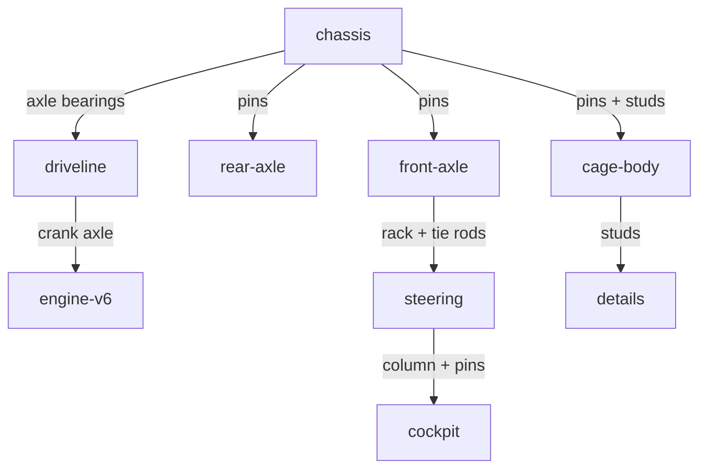

# Brief — crawler-4x4: Inferno 4x4 Rock Crawler Buggy

Amazing Technic model (not a crane): an open off-road buggy with exposed mechanics.

## Subject + size
- Subject: Technic 4x4 rock crawler buggy — ladder chassis, live axles, large off-road wheels, exposed V6 piston engine, working-style steering, roll cage, light bar, rear spare.
- Size: ~16 studs long (Z) × 8 studs wide (X) × ~9 bricks tall to cage top. Road datum Y=0 at tyre contact. Front is -Z.
- Style family: `car` for check comparison, built as Technic (beams/pins/axles/gears, minimal plain bricks).

## Palette (4 roles)
- `Bright_Light_Orange` — dominant body/cage accents, bumpers, engine highlights.
- `Black` — structure: chassis rails, beams, tyres, pins, axles.
- `Light_Bluish_Grey` — mechanical: gears, bushes, engine block, rims.
- `Trans_Clear` + `White` (shared accent slot) — light-bar lenses/headlights, seats/stripes.

Broad surfaces quiet; orange repeated on cage/bumpers/engine, black skeleton clear, grey only where it explains mechanism.

## Focal hierarchy
- Focal: exposed V6 engine bank (crank axle + 6 pistons) in rear half, visible from top/rear/home.
- Support 1: working-style front steering — cockpit hand wheel + column + pinion + rack + tie rods to front hubs.
- Support 2: ladder chassis + propshaft + 8T/24T reduction, high-clearance stance on 4 large wheels.

## Modules

Top-level plan ids = node names. Edges = how the child attaches.

Build order: chassis → axles+wheels → steering → driveline → engine-v6 → cockpit → cage-body → details. One module at a time, `save()` PASS before next.

## Constraints / checks
- Every Technic beam pinned/axled into another layer; every seam bridged; `id=` on key parts.
- Gears on axles (not pins), 8T+24T centres 40 LDU = 2 beam holes.
- Wheels clear of body: narrow spine + lift plates; recompute tyre radius from `m.part().hi`.
- Mirror L/R halves only; centre-line parts outside mirror list.
- Verify: `generate.py` PASS → `check --graph --intended brief.md` → `look` + `view_image` → `deliver`.
