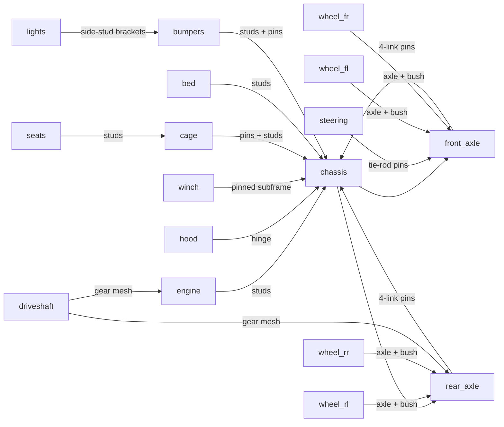

# Ridgeback — a Technic 4×4 trail crawler

Not a crane. A working-gear off-road crawler: portal-style suspension at all four
corners, a front winch, and a hinged bonnet that opens onto a styled engine block.

## Subject and size

- **Subject:** Technic 4×4 trail crawler, chassis-first construction (beams and
  pins visible where they explain the mechanism; body panels close the rest).
- **Size (target, confirmed against real part boxes via `ports`/`part` as built,
  not guessed up front):**
  - Width over fenders: ≈ 9–10 studs (180–200 LDU)
  - Length bumper to bumper: ≈ 36–40 studs (720–800 LDU)
  - Height ground to roll-cage top: ≈ 22–26 studs (440–520 LDU)
- Final numbers are recorded in `delivery/summary.md` after build; this section
  states intent, not a promise to hit an exact stud count.

## Palette (4 colours, by role)

| Colour | Role |
|---|---|
| `Dark_Bluish_Grey` | Structural: chassis rails, beams, suspension arms, mechanicals |
| `Lime` | Body: hood, fenders, bed panels — the identity colour at a glance |
| `Black` | Grounding: tyres, roll cage, trim, bumpers |
| `Trans_Orange` | Accent: headlights, winch-drum highlight — used sparingly |

## Focal feature and supporting features

- **Focal feature:** the engine bay. The hood is a hinged panel (`hinge()`,
  following `hinged-wing.md`'s technique) that opens to reveal a styled inline
  engine block between the front wheels.
- **Supporting feature 1:** portal 4-link suspension at all four corners, carrying
  large knobby tyres well clear of the chassis rails — the "trail crawler" stance.
- **Supporting feature 2:** a gear-driven winch (8T→24T reduction, per
  `gear-train.md`) mounted in a pinned sub-frame in the front bumper.

## Modules

## Honesty notes (filled in further at delivery)

- Wheels, hinge, gear meshes (driveshaft, winch) and steering pins are real
  connected ports, checked by the kit.
- Suspension is built at a static ride-height pose; articulation/travel is not
  simulated. Steering is a pinned linkage at a fixed angle unless shown otherwise.
- The engine is a styled static block unless a real piston/rod/cylinder part is
  found with ports that support an actual slider-crank — this will be stated
  plainly either way after the parts search.
- Reused recipes: `technic-frame.md` (pinned beam rectangle, extended), `gear-train.md`
  (axle/gear/bush, used twice: driveshaft and winch), `small-car.md` (axle→rim→tyre
  `mate()` chain, re-pointed at Technic wheel parts), `hinged-wing.md` (`hinge()`
  technique for the bonnet), `engine-pod.md` (side-stud bracket for lights). No
  official-set source model is extracted or copied; this is an original composition
  built from these generic techniques.
