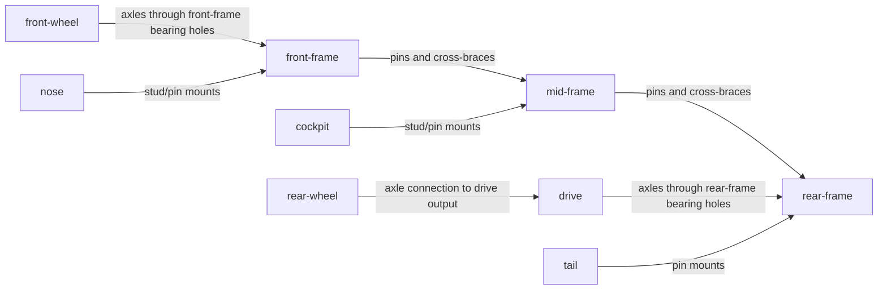

# Saltline X-9 | design brief

Original Technic land-speed streamliner, approximately 12 studs wide by 32-34 studs long. Front faces -Z. A low needle nose flows around an open single-seat cockpit to broad, axle-high rear haunches, with two slim canted-looking tail fins (straight fixed members if hinged fins cannot be supported).

Palette (four roles): White aerodynamic skin; Black tires, pins and cockpit well; Dark_Bluish_Grey exposed load-bearing chassis and gears; Orange as a single narrow longitudinal racing stripe and small tail markings.

Focal feature: visible hand-input reduction gears in the open aft machinery bay, with an intended drive path to the rear rolling wheels. Supporting features: a purposeful tapered shovel nose with paired headlights, and twin rear fins bracketing an exposed diffuser/exhaust. Give the front wheels a narrow, distinct stance and the rear wheels a broader, powerful silhouette. Avoid a generic squared-off car.

Mechanism concept: hand knob -> small 8T gear -> large 24T gear on transverse rear shaft -> rear wheels, with both shafts carried by rigid side structures and retained by bushes. Gear teeth engagement and rolling operation are intended, not analytically verified. Mechanical clearance, physical strength, availability and turning performance are not proven by the model check.

Modules and intended connections (ids are prefixes used for major placements):

Construction starting points: `docs/reference/technic-frame.md` for two pinned beam bays, `docs/reference/gear-train.md` for bearing/shaft/gear/retainer practice. Both are construction techniques; this chassis, streamliner silhouette and body are new. If fitting an actual wheel onto a driven shaft is unsupported by the installed parts, explicitly revise the brief and report the drive limitation rather than pretend it is powered.
