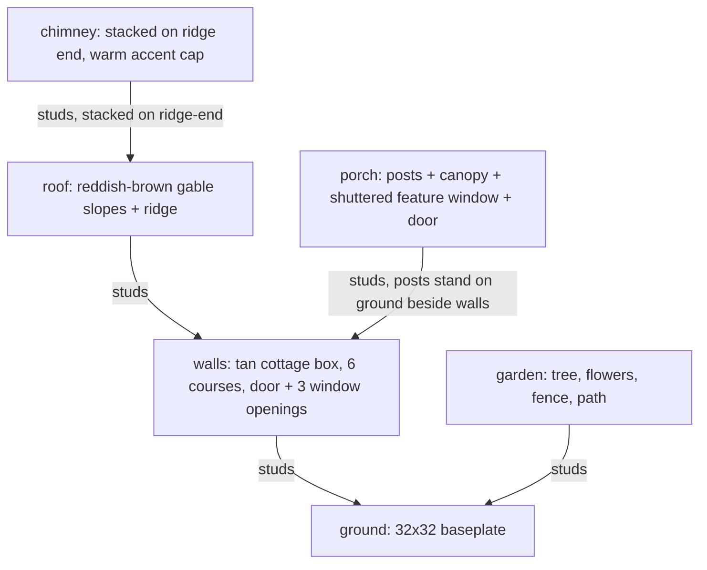

# Hollyhock Cottage

A single-storey storybook cottage: a covered front porch with a shuttered feature window, a
chimney rising beside the roof ridge, a small window tucked into the gable end, and a front
garden with a tree, flower beds, a fence and a stepping-stone path.

**Size:** house footprint 14 x 8 studs, 6 wall courses; chimney rises 4 bricks above the ridge;
porch posts 4 bricks tall, canopy projecting 3 studs in front of the door. Everything sits on one
32 x 32 baseplate, with garden space on both sides and in front of the house.

**Palette**

| Colour | Role |
|---|---|
| Tan | Wall cladding (dominant body colour) |
| Reddish_Brown | Roof, door, door/window frames, porch posts and canopy (wood trim) |
| Dark_Bluish_Grey | Chimney, path stepping-stones |
| Sand_Green | Shutters, small windows, fence |
| Bright_Green / Dark_Green | Lawn / tree foliage |
| Magenta, Yellow, Trans_Orange | Flower accents and a warm chimney-pot glow |

**Focal feature:** the covered front porch — a 4-wide feature window with hinged shutters beside
a panelled door, under a flat canopy on two posts.

**Supporting feature 1:** the chimney, stacked on the ridge end and rising past the roofline, capped
with a small warm Trans_Orange "pot" accent.

**Supporting feature 2:** the front garden corner — an oval tree, flower beds, a picket fence and a
stepping-stone path leading to the porch.

**Reused/adapted:** the wall-with-openings, gable roof, ridge and gable-infill construction follow
the `small-house` recipe pattern (generalised to an arbitrary width/depth), extended with a
feature window + hinged shutters, a chimney, a porch and a garden that the base recipe does not
have.
